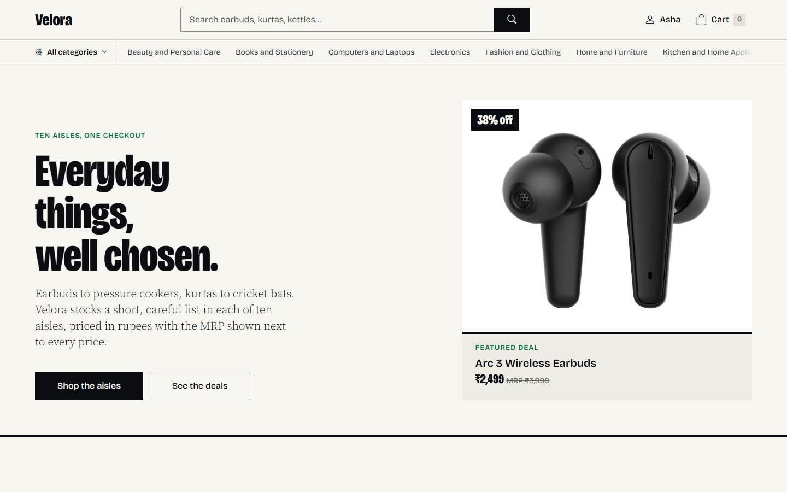
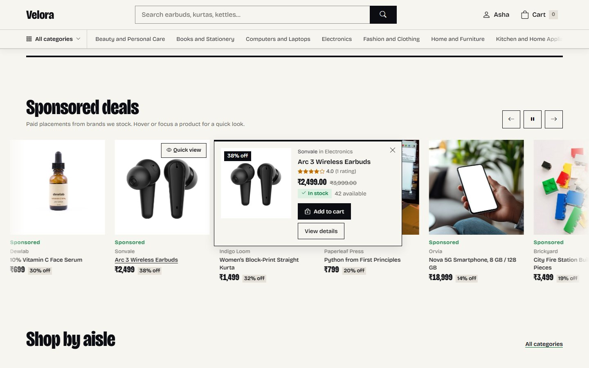
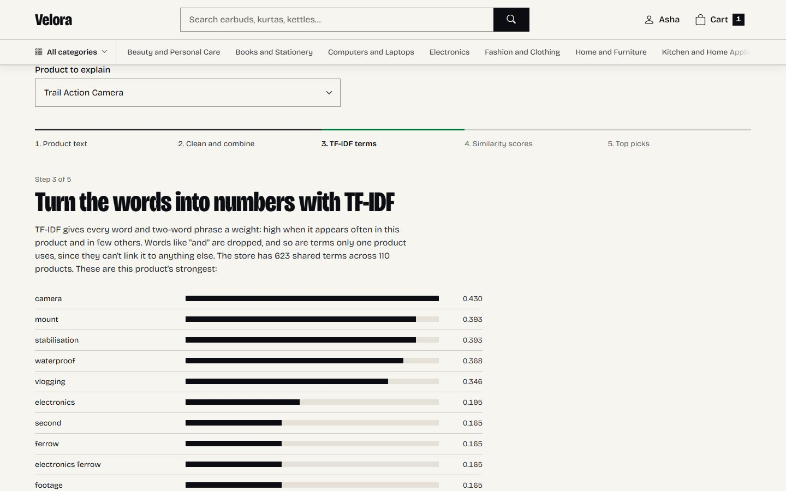
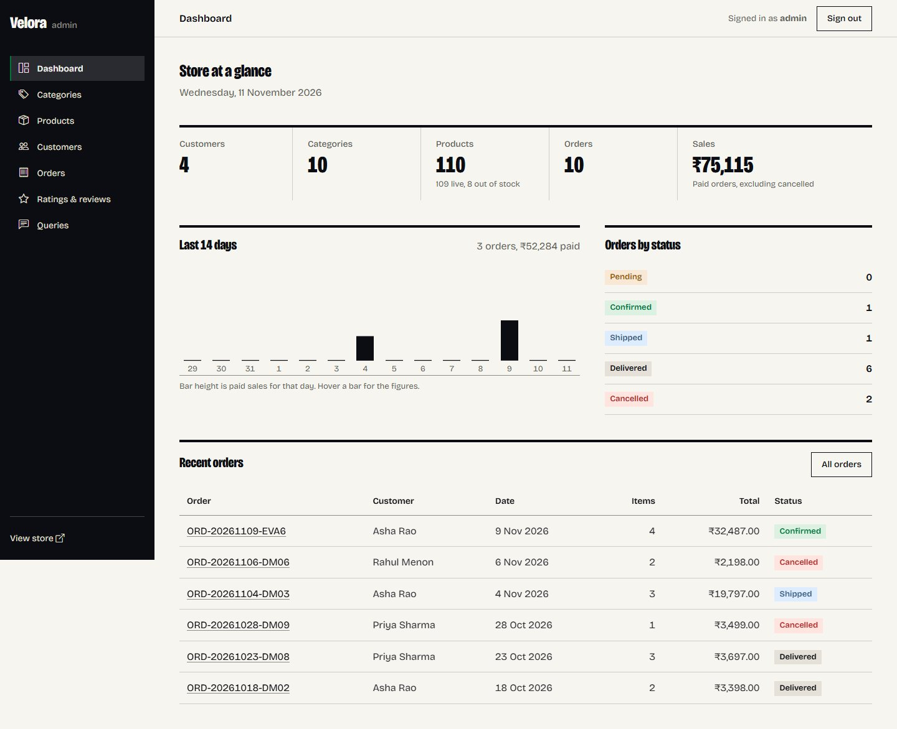
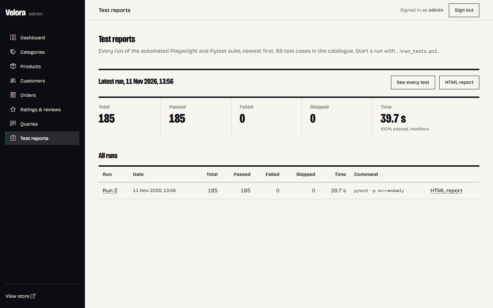
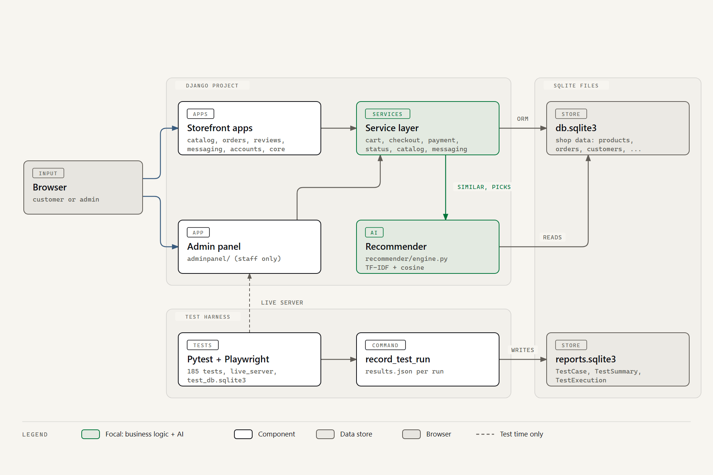

# Velora: a multi-category online store with a local AI recommender

Velora is a complete online store built with Django. It sells products in ten categories, has a separate admin panel, recommends products with a small machine-learning model that runs on your own computer, and comes with a Playwright + Pytest test suite whose results show up inside the admin panel.

It was built as an internship project for VoidMain and runs entirely offline on one Windows laptop, without paid APIs, cloud services or a CDN.



## What it does

Customers can register and sign in with their email, browse the ten categories, search by name, category and price range, read product details and reviews, add products to a cart, check out, pay with a simulated payment (success or failure), get an order email, follow their orders, rate and review products they bought, and send questions to the store.

The admin signs in separately and sees a dashboard (customers, categories, products, orders, sales), manages categories and products (including which products appear in the sponsored strip), activates and deactivates customers, moves orders through Pending, Confirmed, Shipped, Delivered or Cancelled, reads ratings and reviews, answers customer questions, and reviews every automated test run.

The AI recommender compares products by their text (category, name, brand, description and keywords) using TF-IDF and cosine similarity from scikit-learn, with Pandas for the clean-up. It powers:

- *Similar products* on every product page,
- *Recommended for you*, built from what a customer viewed, added to the cart and bought,
- *Popular picks* for new customers who have no history yet,
- the *AI Explainer* page (`/ai/explainer/`), which walks through each step for any product.

Every suggestion shows the product's name, category, image, price, a similarity score and a one-line reason ("Because you bought Electric Kettle").

For testing, 69 browser tests cover every test case in the brief (22 admin, 27 customer, 8 AI, 4 end-to-end) plus 8 extra negative cases, and 117 fast unit tests cover the business rules. Failed browser tests save a screenshot; every run produces an HTML report and is stored for the admin's *Test Reports* page.

| | |
|---|---|
|  |  |
|  |  |

## Tech stack

| Part | Used |
|---|---|
| Web app | Python 3.14, Django 6.1, HTML5, CSS3, JavaScript, Bootstrap 5.3 (restyled), GSAP for motion |
| Database | SQLite: `db.sqlite3` for the shop, `reports.sqlite3` for test results |
| AI | scikit-learn (TfidfVectorizer, cosine_similarity), Pandas, NumPy |
| Testing | Playwright for Python (Chromium), Pytest, pytest-django, pytest-html |
| Tools | VS Code, PowerShell, Django development server |

## How it is put together



Views stay thin. The rules live in service modules (`orders/services/`, `catalog/services.py`, `messaging/services.py`, `reviews/services.py`) and in the recommender (`recommender/engine.py`). Two more diagrams explain the recommender's data flow and the checkout transaction: [docs/diagrams/](docs/diagrams/). For a file-by-file tour, read [docs/CODE_MAP.md](docs/CODE_MAP.md).

## Setup on Windows (PowerShell)

You need Python 3.14 and Git. All commands run from the project folder.

```powershell
git clone https://github.com/Krishna141414/ai-multicategory-ecommerce.git
cd ai-multicategory-ecommerce

# 1. A virtual environment and the pinned packages
py -3.14 -m venv .venv
.\.venv\Scripts\Activate.ps1
python -m pip install -r requirements.txt
python -m playwright install chromium        # the browser for the tests (one time)

# 2. Settings: copy the example and edit it
Copy-Item .env.example .env
#    Open .env and set SECRET_KEY, ADMIN_PASSWORD and DEMO_CUSTOMER_PASSWORD

# 3. Databases: the shop and the separate test-results store
python manage.py migrate
python manage.py migrate --database reports

# 4. The admin account (read from .env), demo data and the recommender
python manage.py create_default_admin
python manage.py seed_demo
python manage.py build_recommender
python manage.py sync_test_catalog

# 5. Run it
python manage.py runserver
```

Open <http://127.0.0.1:8000/> for the store and <http://127.0.0.1:8000/manage/> for the admin panel.

- Admin: the `ADMIN_USERNAME` and `ADMIN_PASSWORD` from your `.env`.
- Demo customers: `asha.rao@example.com`, `rahul.menon@example.com`, `priya.sharma@example.com` and `imran.qureshi@example.com`, all with the `DEMO_CUSTOMER_PASSWORD` from your `.env`.

> **Change the default admin password before deploying anywhere.** The values in `.env.example` are placeholders for a local demo. `.env` is git-ignored and must never be committed. Run `python manage.py create_default_admin --reset-password` after changing `ADMIN_PASSWORD` to apply the new one.

To put the demo data back the way it started (for example before recording a demo): `python manage.py reset_demo --yes`. This deletes shop data only; test reports are kept.

## Running the tests

```powershell
.\run_tests.ps1                         # everything, headless (about 40 seconds)
.\run_tests.ps1 -Suite customer         # one group: unit, admin, customer, ai, e2e, negative
.\run_tests.ps1 -Suite e2e -Headed      # watch it in a real browser window, slowed down (400 ms per step)
.\run_tests.ps1 -Headed -SlowMo 800     # slower still, for a video
.\run_tests.ps1 -Random                 # shuffle the order (every test is independent)
.\run_tests.ps1 -NoRecord               # write the HTML report but do not store the run
```

Pytest can also be called directly, for example `python -m pytest -k test_dummy_payment --headed`.

The browser tests run against a temporary copy of the app with its own test databases (`test_db.sqlite3`, `test_reports.sqlite3`), so they never change your shop data. Each test creates exactly the data it needs.

### Where the results go

| What | Where |
|---|---|
| Latest HTML report | `reports/report.html` |
| Each run's HTML report and results | `reports/runs/<date-time>/` |
| Screenshots of failed tests | `reports/screenshots/<date-time>/` |
| Every recorded run | Admin panel, Test reports page (`/manage/test-reports/`), with Passed / Failed / Skipped filters, timings and screenshots |

`python manage.py clean_test_reports` lists which folders in `reports/` belong to a recorded run and which are leftovers (for example from `-NoRecord` runs); add `--delete` to remove only the leftovers.

## Project structure

```
config/          settings, URLs, database router (shop vs test reports)
core/            home page, permissions, middleware, demo data commands
accounts/        customers: registration, email login, profile, default admin
catalog/         categories, products, search, product pages, quick view
orders/          cart, checkout, dummy payment, orders, order email
reviews/         ratings and reviews (buyers only)
messaging/       customer questions and admin replies (one messages table)
recommender/     the AI engine, its data tables and the AI pages
adminpanel/      the admin panel, including Test Reports
testreports/     stored test runs (reports.sqlite3) and their commands
templates/       HTML templates for every page
static/          CSS, JavaScript, fonts and vendored libraries (no CDN)
media/           product photos
tests/           unit/, admin/, customer/, ai/, e2e/, page objects, factories, test catalogue
docs/            brief, design system, decisions, requirements matrix, code map, test cases, diagrams, audits
run_tests.ps1    the test runner
```

## Documentation

| File | What it covers |
|---|---|
| [docs/PROJECT_BRIEF.md](docs/PROJECT_BRIEF.md) | The project brief: every feature and rule |
| [docs/REQUIREMENTS_MATRIX.md](docs/REQUIREMENTS_MATRIX.md) | Each brief item, where it is built, and which test covers it |
| [docs/CODE_MAP.md](docs/CODE_MAP.md) | Every file and how they connect, flow by flow |
| [docs/TEST_CASES.md](docs/TEST_CASES.md) | The test case catalogue and the latest results |
| [docs/DESIGN_SYSTEM.md](docs/DESIGN_SYSTEM.md) | Colours, type, spacing and motion |
| [docs/DECISIONS.md](docs/DECISIONS.md) | Choices made along the way, and why |
| [docs/IMAGE_CREDITS.md](docs/IMAGE_CREDITS.md) | Where every product photo comes from |
| [docs/audits/](docs/audits/) | Design and accessibility audits |

## Limitations

- Payments are simulated. No money moves and no payment provider is involved.
- Emails are written to the `sent_emails/` folder by default. Real sending needs SMTP settings in `.env` (`EMAIL_MODE=smtp`).
- SQLite and the Django development server suit a local demo. A real deployment would need a production database, a proper web server for static and media files, HTTPS and new secrets.
- The recommender learns from product text and the customer's own activity. It does not learn from other customers' behaviour (collaborative filtering), and with 110 products its vocabulary is small.
- Brands and products are fictional. Product photos are credited in [docs/IMAGE_CREDITS.md](docs/IMAGE_CREDITS.md).
